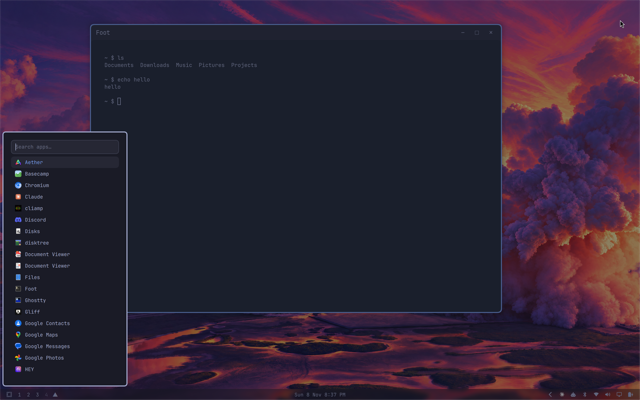
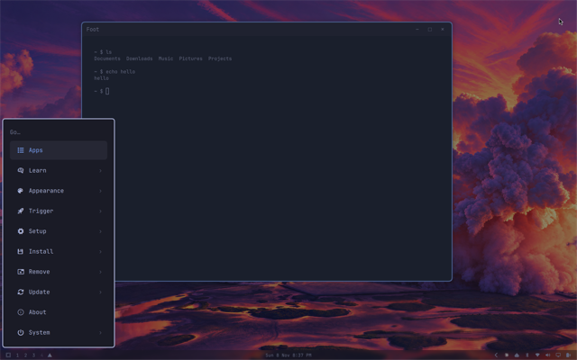
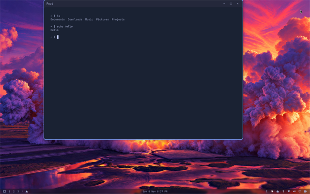
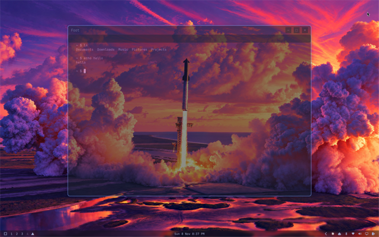
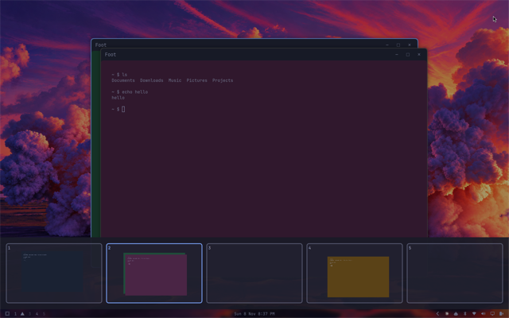
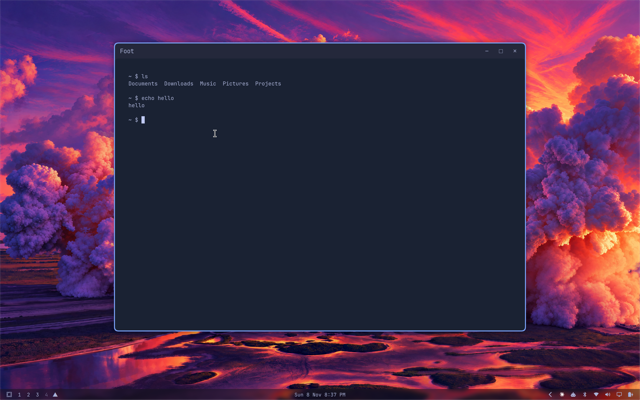

# omarchy-dtp-install

Installs every `omarchy-dtp-<feature>` repo.

```bash
git clone https://github.com/dtpietrzak/omarchy-dtp-install.git
cd omarchy-dtp-install
./install.sh
```

Each feature stays in its own repo and installs itself. This script runs those installers in the order listed in `install.sh`. Running it again leaves anything that already matches untouched.

A checkout next to this repo is used when it is there. Otherwise the git URL on that feature's line is cloned into `~/.local/share/omarchy-dtp/<name>` and then installed. Add the next feature as `"omarchy-dtp-<feature> <git-url>"`.

## Features

- `omarchy-dtp-app-list`, the list launcher. Plugin id `dtpietrzak.applist`.
- `omarchy-dtp-no-dock`, turns the dock off. It runs after the app list.
- `omarchy-dtp-start-menu`, opens Super+Space and Super+Alt+Space in the corner beside the menu button. It runs after the app list.
- `omarchy-dtp-floating-titlebar-limits`, keeps a floating title bar on the screen.
- `omarchy-dtp-workspace-swipe`, four finger workspace swipe with a fade and a 7.5% commit.
- `omarchy-dtp-workspace-control`, four finger swipe up for a panel of workspaces and their windows, with drag and drop. Plugin id `dtpietrzak.workspacecontrol`.
- `omarchy-dtp-config`, personal settings: cursor size, touchpad, text size, bar, dock pins, and the Chromium video flag. It runs last.

## Screenshots

### omarchy-dtp-app-list



### omarchy-dtp-no-dock


### omarchy-dtp-start-menu



### omarchy-dtp-floating-titlebar-limits



### omarchy-dtp-workspace-swipe



### omarchy-dtp-workspace-control



### omarchy-dtp-config


