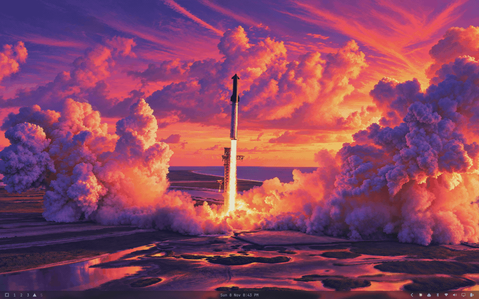
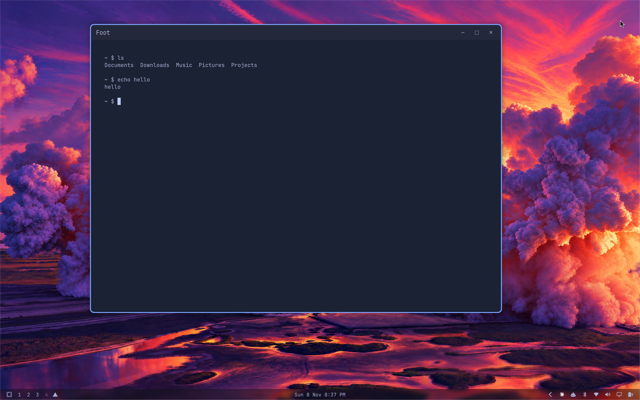
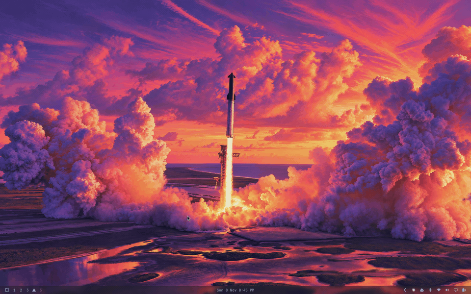
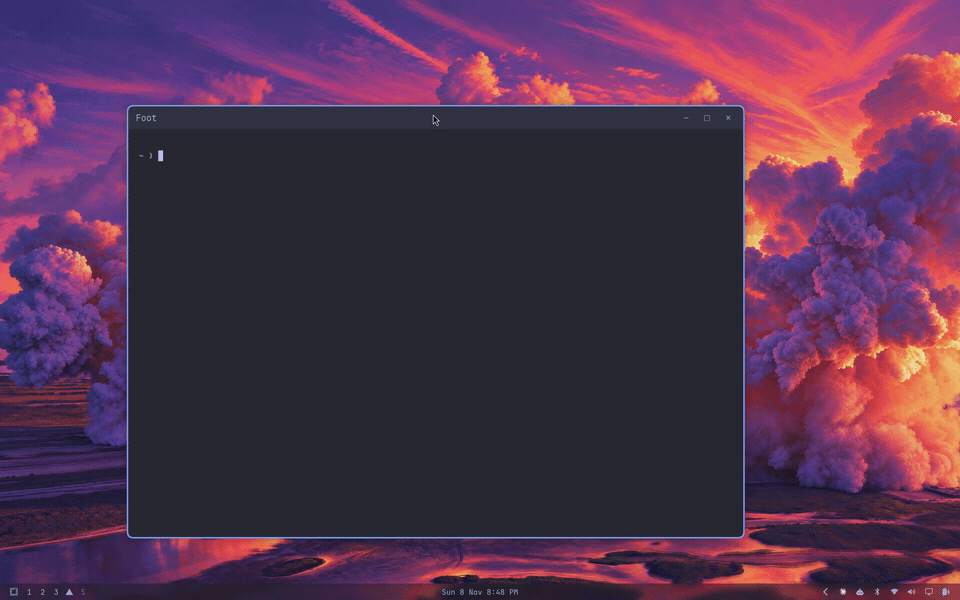
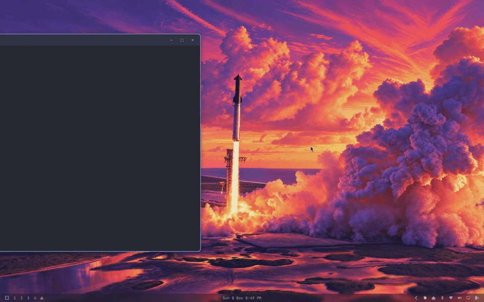
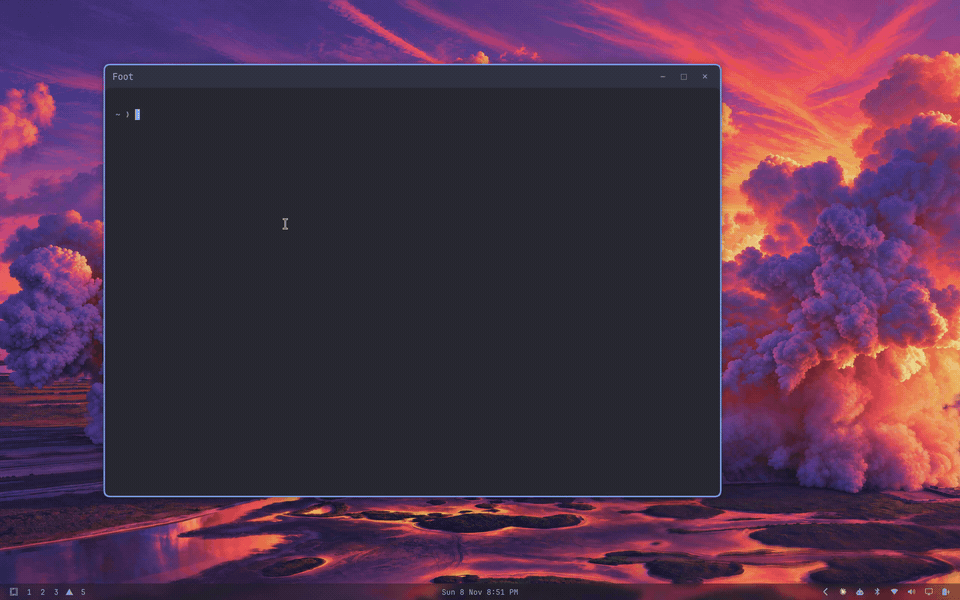

# omarchy-dtp-install

Installs the `omarchy-dtp-<feature>` repos you pick.

```bash
git clone https://github.com/dtpietrzak/omarchy-dtp-install.git
cd omarchy-dtp-install
./install.sh
```

The script opens a checklist with every feature ticked. `x` toggles a feature, Enter continues, and you confirm before anything installs. To skip the checklist and install everything, for example from another script, run `./install.sh --all`.

Each feature stays in its own repo and installs itself. This script runs the chosen installers in the order listed in `install.sh`. Running it again leaves anything that already matches untouched.

A checkout next to this repo is used when it is there. Otherwise the git URL on that feature's line is cloned into `~/.local/share/omarchy-dtp/<name>` and then installed. Add the next feature as `"omarchy-dtp-<feature>|<git-url>|<description>"`.

## Features

- `omarchy-dtp-app-list`, the list launcher. Plugin id `dtpietrzak.applist`.
- `omarchy-dtp-no-dock`, turns the dock off. It runs after the app list.
- `omarchy-dtp-bar`, a copy of the Omarchy bar whose glassy background follows the theme's `glass-alpha`. Needs `omarchy-dtp-theme` for the value; falls back to stock.
- `omarchy-dtp-menu`, the Omarchy menu restyled like the workspace control menus and placed in the corner. Plugin id `io.github.dtpietrzak.menu`. It runs before start-menu.
- `omarchy-dtp-tray-auto-hide`, the system tray with its chevron hidden until the pointer is over the right side of the bar. Plugin id `io.github.dtpietrzak.tray-auto-hide`.
- `omarchy-dtp-tray-the-stocks`, moves the agents, Bluetooth, Wi-Fi, sound and display buttons into the tray drawer. Edits `shell.json`; run after tray-auto-hide.
- `omarchy-dtp-glass-popups`, the bar flyouts follow the bar's glassy, opaque or clear look, with blur. Pairs with the theme.
- `omarchy-dtp-theme`, the shared look as an Omarchy theme (Tokyo Night plus shell overrides). Switches the machine to the `dtp` theme.
- `omarchy-dtp-start-menu`, opens Super+Space and Super+Alt+Space in the corner beside the menu button. It runs after the app list.
- `omarchy-dtp-floating-titlebar-limits`, keeps a floating title bar on the screen.
- `omarchy-dtp-workspace-swipe`, four finger workspace swipe with a fade and a 7.5% commit.
- `omarchy-dtp-workspace-control`, four finger swipe up for a panel of workspaces and their windows, with drag and drop, and workspace numbers on the bar in place of the stock ones. Plugin id `io.github.dtpietrzak.workspace-control`.
- `omarchy-dtp-config`, personal settings: cursor size, touchpad, text size, bar, dock pins, and the Chromium video flag. It runs last.

## Screenshots

### omarchy-dtp-app-list



### omarchy-dtp-no-dock



### omarchy-dtp-start-menu



### omarchy-dtp-floating-titlebar-limits



### omarchy-dtp-workspace-swipe



### omarchy-dtp-workspace-control



### omarchy-dtp-config


